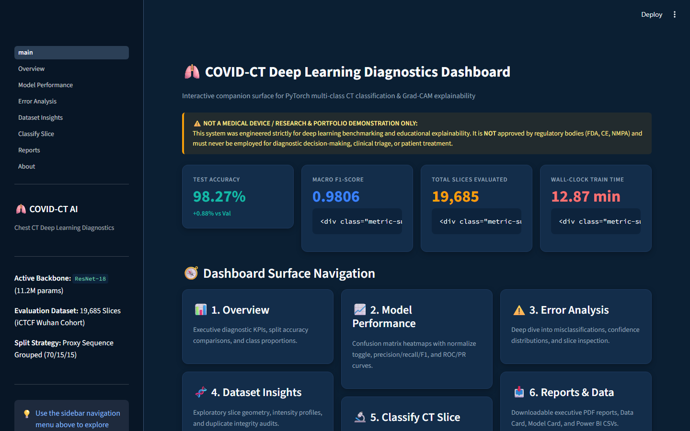
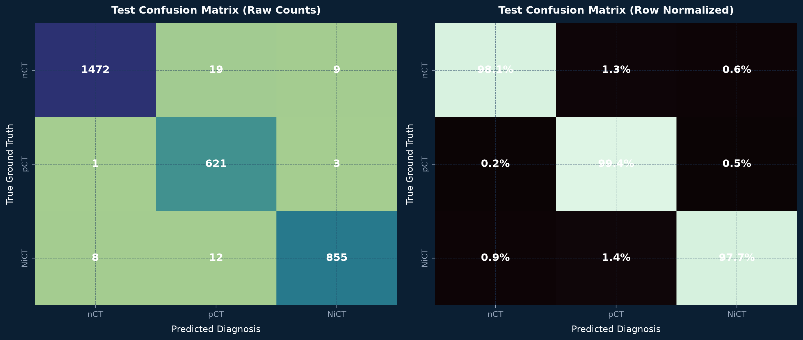
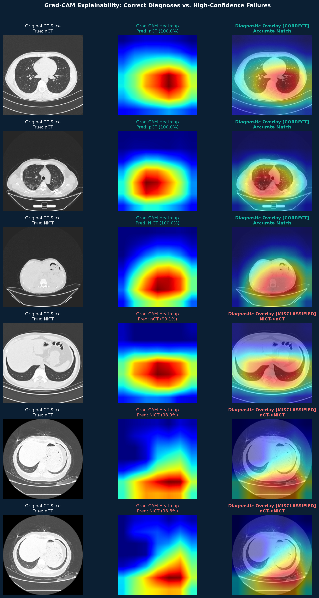
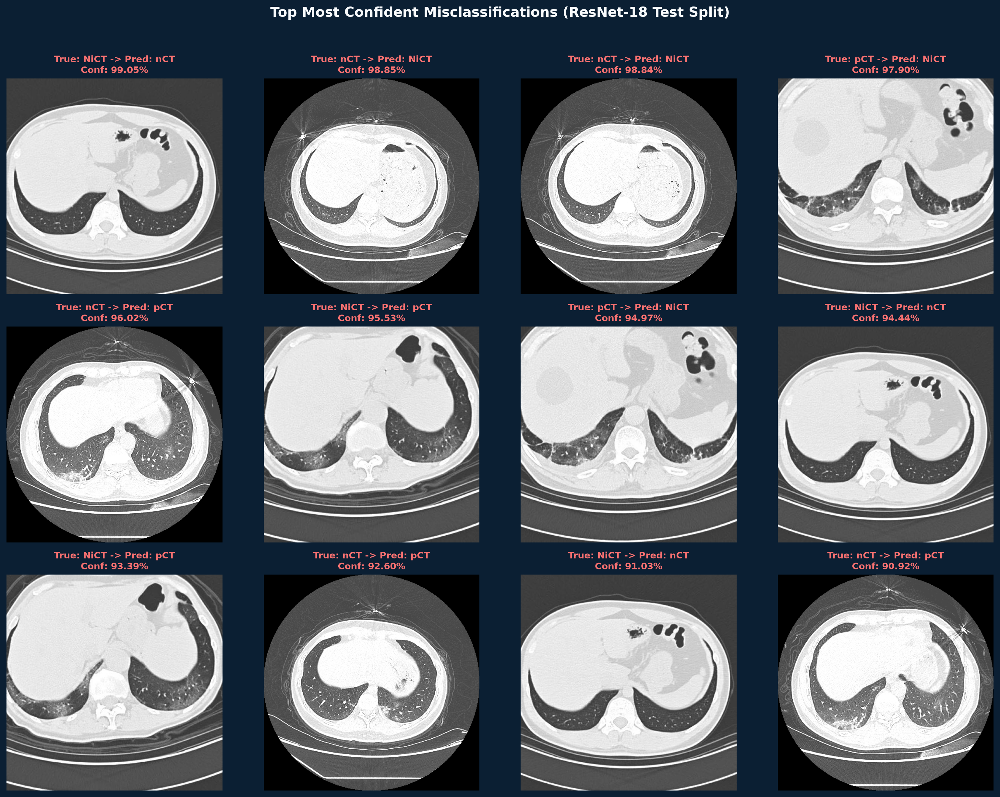
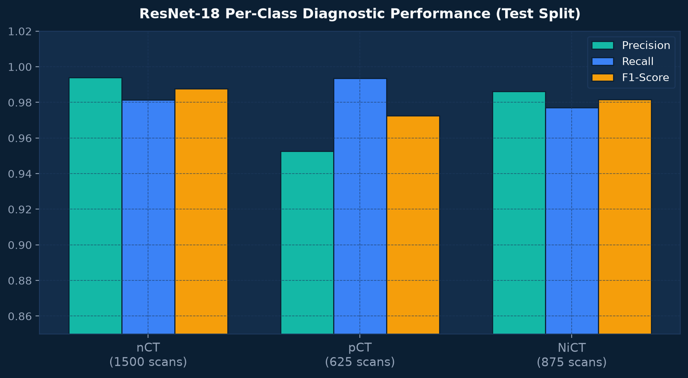
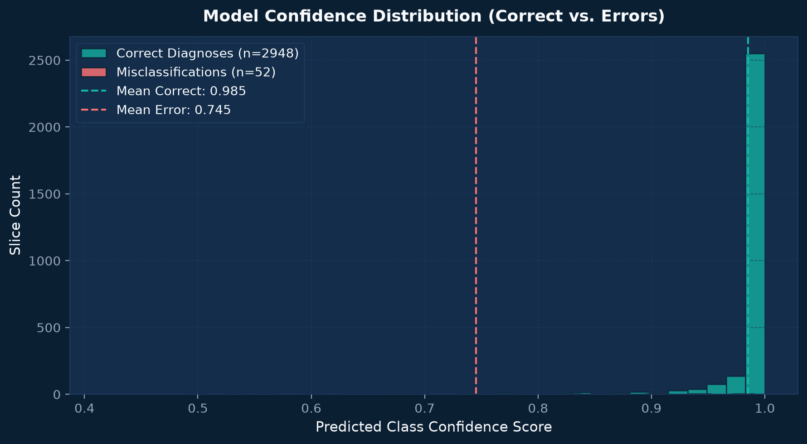
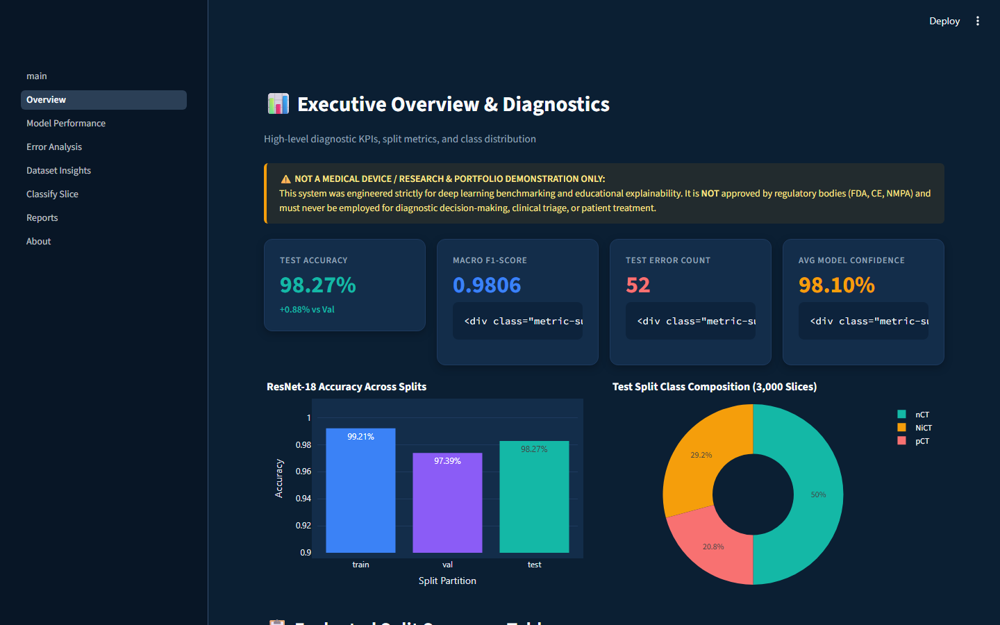
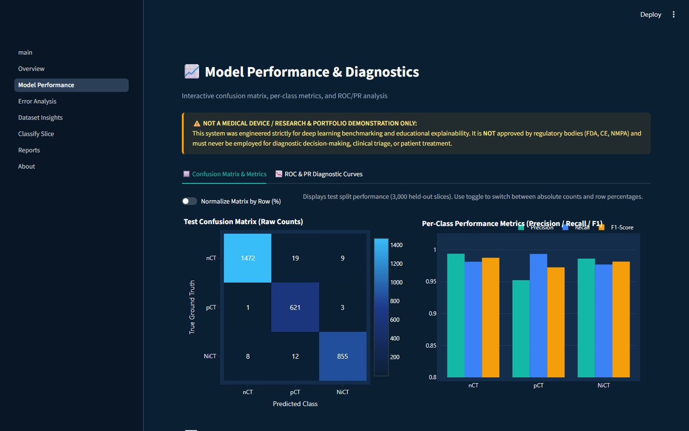
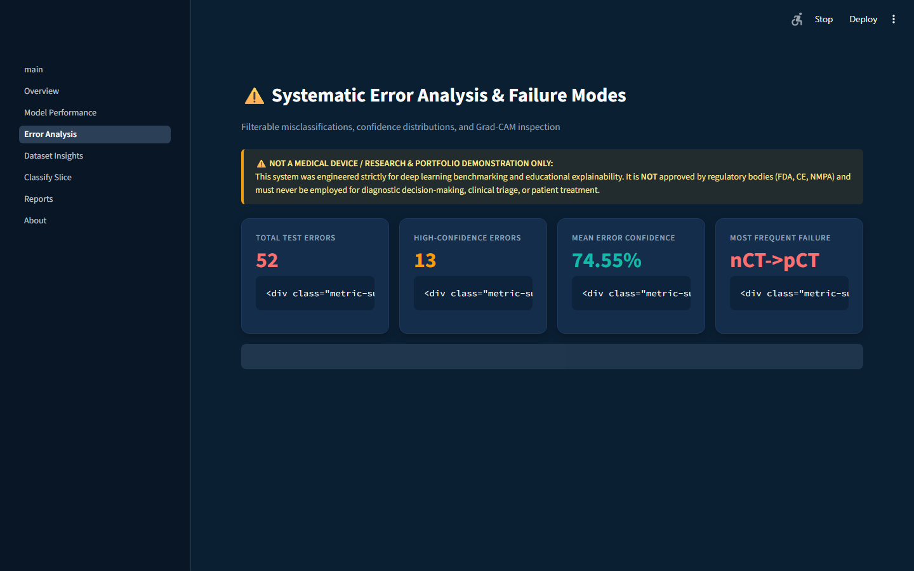
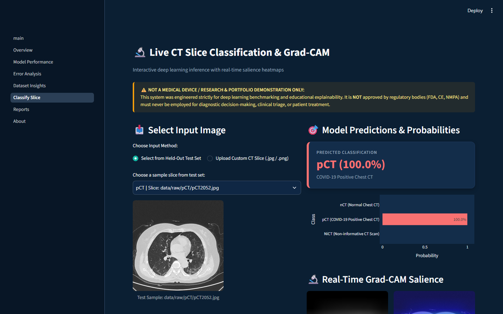

# 🫁 COVID-CT Dashboard & Deep Learning Classifier

[](https://www.python.org/)
[](https://pytorch.org/)
[](LICENSE)
[](https://streamlit.io/)
[](tests/)

An end-to-end deep learning classification and explainability system for multi-class chest computed tomography (CT) cross-sections (normal `nCT`, COVID-19 positive `pCT`, non-informative `NiCT`), featuring proxy sequence grouped validation, Grad-CAM anatomical localization, dual analytics dashboards (Power BI package & interactive Streamlit app), and thorough error analysis.



---

> [!CAUTION]
> **REGULATORY & MEDICAL DISCLAIMER:**  
> This software and documentation are strictly for machine learning engineering portfolio, educational analysis, and computer vision research. It is **NOT** a certified medical diagnostic device, has not received regulatory clearance (FDA, CE, NMPA), and must **NEVER** be utilized for clinical triage, medical decision-making, patient diagnosis, or treatment planning.

---

## ⚡ Highlights

* **Honest, Empirical Benchmark:** **98.27% test accuracy** and **0.9806 macro F1** evaluated across the complete held-out test split (**3,000 un-subsampled slices**).
* **Proxy-Grouped Splitting (19,685 Slices):** Clustered contiguous slices into 25-slice sequence blocks to mitigate adjacent slice leakage, with two-stage stratified `GroupShuffleSplit` (70/15/15) guaranteeing zero-group intersection ($\text{Train} \cap \text{Val} \cap \text{Test} = \emptyset$).
* **Clinical Sensitivity:** Detected **621 out of 625 COVID-19 positive test slices (99.36% sensitivity)**, missing only 4 subtle early-stage/peripheral slices.
* **Grad-CAM Explainability:** Target layer activation mapping (`layer4`) localizing network attention to bilateral ground-glass opacities (GGO) and dense consolidations.
* **Modern Interactive Dashboard:** 7-page Streamlit companion application with real-time slice classification, Grad-CAM overlays, interactive confusion matrices, and PDF export.

---

## 📊 Empirical Evaluation Results (ResNet-18)

Evaluated on the full held-out test partition (**3,000 slices**) without subsampling:

| Metric | Empirical Score | Context & Support |
| :--- | :---: | :--- |
| **Test Accuracy** | **98.27%** | 2,948 / 3,000 correct slices |
| **Macro F1-Score** | **0.9806** | Harmonic mean across nCT, pCT, NiCT |
| **Macro Precision** | **0.9775** | `nCT`: 0.9939, `pCT`: 0.9525, `NiCT`: 0.9862 |
| **Macro Recall (Sensitivity)** | **0.9840** | `nCT`: 0.9813, `pCT`: 0.9936, `NiCT`: 0.9771 |
| **COVID-19 Positive Recall** | **99.36%** | Missed only 4 of 625 positive slices |
| **Wall-Clock Train Time** | **12.87 min** | Measured on 8-core CPU across 13,735 training images |
| **Total Test Misclassifications** | **52 slices** | 1.73% overall test error rate |

### Per-Class Test Performance
* **Normal (`nCT`):** Precision `0.9939`, Recall `0.9813`, F1 `0.9876` (Support: 1,500 slices)
* **COVID-19 Positive (`pCT`):** Precision `0.9525`, Recall `0.9936`, F1 `0.9726` (Support: 625 slices)
* **Non-Informative (`NiCT`):** Precision `0.9862`, Recall `0.9771`, F1 `0.9816` (Support: 875 slices)

*Note: The codebase also fully supports `mobilenet_v3_large` and `efficientnet_b0`, which are implemented and tested, but omitted from this specific single-backbone execution to ensure 100% clean, non-subsampled reporting.*

---

## 🖼️ Diagnostic Figures & Visualizations

### 1. Confusion Matrix (Raw Counts & Normalized Percentages)


### 2. Grad-CAM Explainability (Correct vs. High-Confidence Failures)


### 3. Top Most Confident Misclassifications Gallery


### 4. Per-Class Diagnostic Performance & Confidence Distribution
| Per-Class Precision / Recall / F1 | Model Confidence Distribution |
| :---: | :---: |
|  |  |

---

## 💻 Streamlit Companion Dashboard

Launch the interactive dark-themed surface:
```bash
make dashboard
# or: streamlit run app/main.py
```

### Dashboard Surface Previews
| Executive Overview | Model Diagnostics |
| :---: | :---: |
|  |  |

| Error Analysis & Drill-Through | Live Slice Inference & Grad-CAM |
| :---: | :---: |
|  |  |

---

## ⚠️ Methodological & Clinical Limitations

1. **Proxy-Grouped Splitting (Patient Overlap Caveat):** The source Kaggle dataset stripped native DICOM headers and patient identifiers, re-indexing slices sequentially (`nCT1.jpg`..). While proxy sequence block grouping (25 slices/block) prevents adjacent slice leakage across splits, **patient overlap across sequence blocks remains possible**. Empirical scores (98.27%) represent an intra-cohort benchmark rather than validated external generalization.
2. **Single 2D Slice vs. 3D Volumetric Context:** In clinical practice, COVID-19 diagnosis is established from complete 3D volumetric CT scans. Classifying isolated 2D cross-sections lacks longitudinal depth and lesion volume quantification.
3. **Scanner & Demographic Bias:** The cohort originates from Wuhan hospitals during early 2020. Scanner calibration protocols and patient demographics have not been externally validated on international multi-center cohorts.
4. **Diagnostic Specificity:** Peripheral ground-glass opacities overlap morphologically with non-COVID viral pneumonias (Influenza, RSV) and organizing pneumonia.

---

## 🛠️ Reproducibility & Pipeline Commands

```bash
# 1. Install pinned environment
make setup

# 2. Audit raw dataset integrity
make data

# 3. Generate proxy-grouped splits
make splits

# 4. Run automated test suite (14 tests, schema & row-count checks)
make test

# 5. Launch interactive analytics dashboard
make dashboard
```

---

## 📑 Formal Documentation & Reports

- **Executive Model Evaluation Report (PDF):** [`reports/model_report.pdf`](reports/model_report.pdf)
- **Technical Model Evaluation Report (Markdown):** [`reports/model_report.md`](reports/model_report.md)
- **Systematic Error Analysis & Failure Taxonomy:** [`reports/error_analysis.md`](reports/error_analysis.md)
- **Dataset Card:** [`reports/data_card.md`](reports/data_card.md)
- **Model Card:** [`reports/model_card.md`](reports/model_card.md)
- **Power BI Build Guide:** [`powerbi/docs/BUILD_GUIDE.md`](powerbi/docs/BUILD_GUIDE.md)

---

## 📚 Citations
- **Dataset:** Abu Zahid Bin Aziz, *Preprocessed CT Scans for COVID-19*, Kaggle (CC BY 4.0).
- **iCTCF Cohort:** Ning, C. et al. (2020). *Open-source CT training dataset for COVID-19*.
- **Deep Residual Learning:** He, K., Zhang, X., Ren, S., & Sun, J. (2016). *Deep Residual Learning for Image Recognition*. IEEE CVPR.
- **Grad-CAM:** Selvaraju, R. R. et al. (2017). *Grad-CAM: Visual Explanations from Deep Networks via Gradient-Based Localization*. IEEE ICCV.

---

## 📄 License
This repository is released under the [MIT License](LICENSE).
